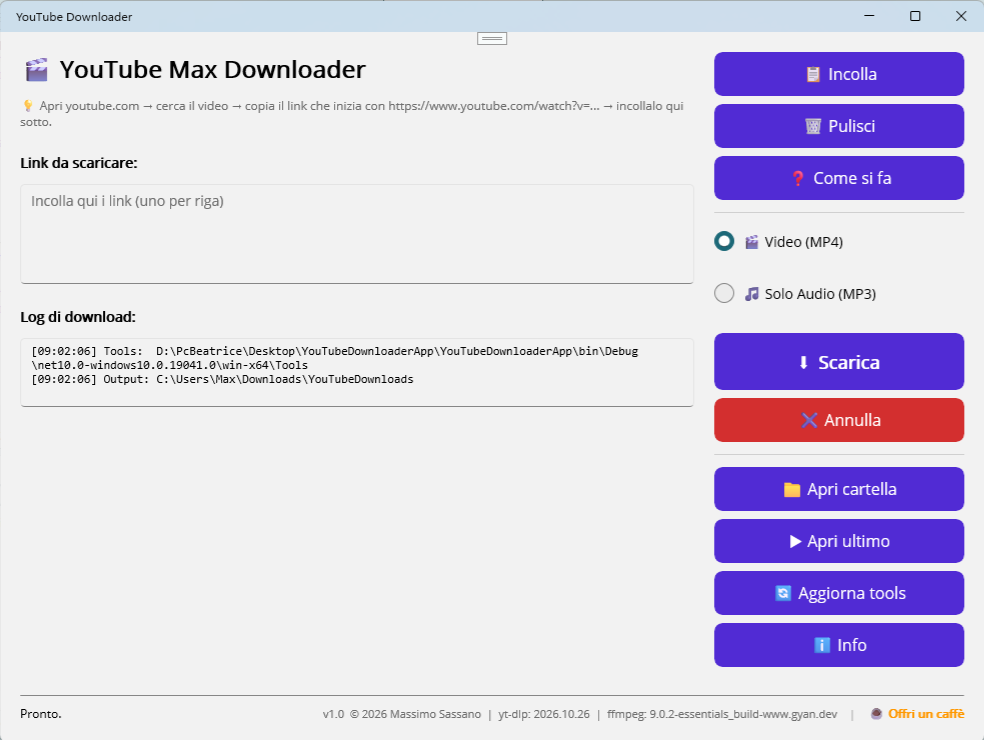

# YouTube Max Downloader — App per scaricare video e MP3

  

Applicazione Windows per scaricare video o solo audio da YouTube in un click.
Interfaccia pulita, supporto per link multipli, riconoscimento automatico dei link
"sporchi" (playlist, timestamp, shorts) e aggiornamento automatico integrato dei tool.

**Versione:** 1.0.0  
**Autore:** Massimo Sassano  
**Anno:** 2026  
**Sito / Repository:** [github.com/maxsassano/YoutubeMaxDownloader](https://github.com/maxsassano/YoutubeMaxDownloader)

---

## 1. Requisiti

- Windows 10 o superiore (64-bit)
- Connessione Internet
- Nessuna installazione richiesta: l'app è **portabile** (basta scompattare la cartella ed eseguire l'exe)

---

## 2. Come si usa (Passo passo)

1. Apri **youtube.com** nel tuo browser.
2. Cerca il video che ti interessa.
3. Copia dalla barra degli indirizzi il link (es. `https://www.youtube.com/watch?v=F7katA08VeA`).
4. Apri l'app e incolla il link nel campo **"Link da scaricare:"** (puoi usare il pulsante `📋 Incolla` o incollare a mano).
   *Puoi incollare più link insieme, uno per riga: verranno scaricati in sequenza.*
5. Scegli se scaricare:
   - 🎬 **Video + Audio (MP4)**
   - 🎵 **Solo Audio (MP3)**
6. Clicca **`⬇ Scarica`**.

I file verranno salvati automaticamente in:  
`C:\Users\<TuoNome>\Downloads\YouTubeDownloaderApp \`

---

## 3. Aggiornamento Tool (Fondamentale)

YouTube cambia i suoi sistemi di protezione molto spesso. Per questo motivo, l'app
include un sistema di aggiornamento automatico per i suoi due "motori interni":

- **yt-dlp** (per il download)
- **FFmpeg** (per la conversione in MP3 e il merge in MP4)

**Consiglio:** clicca il pulsante **`🔄 Aggiorna tools`** ogni 2-3 settimane.
Se i download iniziano a fallire con errori strani, il 99% delle volte è perché
yt-dlp è troppo vecchio.

*Sicurezza:* l'app scarica i nuovi file, verifica l'hash **SHA-256** contro il
manifest ufficiale di GitHub, fa un backup della versione vecchia e la ripristina
automaticamente se la nuova versione risulta corrotta o non funzionante.

---

## 4. Interfaccia

### 🔹 Colonna Sinistra
- **Link da scaricare:** casella dove incollare gli URL.
- **Log di download:** mostra in tempo reale cosa sta facendo yt-dlp, inclusi eventuali errori.

### 🔹 Colonna Destra (Pulsanti)
- `📋 Incolla` — incolla dagli appunti.
- `🗑 Pulisci` — svuota la casella dei link.
- `❓ Come si fa` — guida rapida in-app.
- `⬇ Scarica` — avvia il download.
- `✖ Annulla` — ferma il download in corso.
- `📁 Apri cartella` — apre Esplora risorse nella cartella output.
- `▶ Apri ultimo` — riproduce l'ultimo file scaricato.
- `🔄 Aggiorna tools` — aggiorna yt-dlp e/o ffmpeg.
- `ℹ Info` — informazioni, crediti e link per supportare il progetto.

### 🔹 Barra Inferiore
- **Barra di avanzamento:** mostra la percentuale, la velocità (MB/s) e il tempo stimato (ETA).
- **Status:** messaggio di stato corrente.
- **Footer:** versione dell'app, crediti e link per offrirmi un caffè ☕.

---

## 5. Gestione intelligente dei link

L'app riconosce e pulisce automaticamente qualsiasi variante di link tu incolli:

| Incolli questo | L'app scarica |
|----------------|---------------|
| `https://www.youtube.com/watch?v=ID` | ✅ |
| `https://www.youtube.com/watch?v=ID&list=PLxxx` | ✅ (ignora la playlist) |
| `https://youtu.be/ID?t=42` | ✅ (ignora il tempo) |
| `https://www.youtube.com/shorts/ID` | ✅ |
| `ID` (solo l'ID di 11 caratteri) | ✅ |

---

## 6. Formati di output

- **Video:** MP4 (H.264 + AAC). Viene scaricata la miglior qualità disponibile in formato MP4 e i flussi video/audio vengono uniti insieme.
- **Audio:** MP3 a qualità massima (VBR ~200-250 kbps). Perfetto per chiavette USB, autoradio e smartphone.

---

## 7. Limiti noti

- **Video privati o con restrizioni di età:** potrebbero non essere scaricabili perché richiedono l'accesso con un account. *(Soluzione futura: implementazione del supporto ai cookie del browser).*
- **YouTube "Bot detection":** se scarichi centinaia di video di fila, YouTube potrebbe bloccarti temporaneamente per traffico anomalo. In quel caso, attendi qualche ora o usa una VPN.
- **Playlist intere:** al momento l'app scarica solo il video singolo, ignorando il parametro `list=`.

---

## 8. Problemi comuni

| Problema | Soluzione |
|----------|-----------|
| "La nuova yt-dlp non risponde" durante l'aggiornamento | L'app ha fatto rollback automatico. Riprova più tardi o scarica manualmente l'ultima versione di `yt-dlp.exe` da GitHub. |
| Errore `HTTP 403 Forbidden` | yt-dlp è vecchio. Clicca `🔄 Aggiorna tools`. |
| L'MP3 non viene creato (solo file strani) | Manca `ffmpeg.exe` nella cartella `Tools\`. Clicca `🔄 Aggiorna tools` e seleziona l'opzione completa. |
| L'app si apre ma è tutta bianca | Problema di cache di .NET MAUI. Chiudi Visual Studio, cancella le cartelle `bin` e `obj`, ricompila. |
| Antivirus blocca l'exe | Falso positivo noto di Windows Defender su app compilate con .NET MAUI. Aggiungi un'esclusione. |

---

## 9. Changelog

### v1.0.0 (2026)
- ✅ Rilascio iniziale.
- ✅ Download Video (MP4) e Audio (MP3).
- ✅ Supporto per link multipli (uno per riga).
- ✅ Normalizzazione automatica dei link (youtu.be, shorts, parametri sporchi).
- ✅ Sistema di aggiornamento integrato per yt-dlp e ffmpeg con verifica SHA-256 e rollback.
- ✅ Pagina Info con privacy policy, crediti e link di supporto.

---

## 10. Crediti

- **Software:** YouTube Downloader v1.0
- **Framework:** .NET MAUI (C#) su Visual Studio 2026
- **Libreria wrapper:** [YoutubeDLSharp](https://github.com/Bluegrams/YoutubeDLSharp)
- **Download Engine:** [yt-dlp](https://github.com/yt-dlp/yt-dlp) (Unlicense)
- **Audio/Video Engine:** [FFmpeg](https://ffmpeg.org/) (LGPL)

---

**YouTube Downloader v1.0**  
© 2026 **Massimo Sassano** — Tutti i diritti riservati.

Sviluppato in C# con .NET MAUI su Visual Studio 2026.

Licenza del software: uso personale.  
L'app non è affiliata a YouTube, Google o a yt-dlp.

---

## ☕ Sostieni il progetto

Se l'app ti è utile, puoi offrirmi un caffè:

Ogni contributo aiuta a mantenere il progetto attivo e senza pubblicità. Grazie! 🙏
